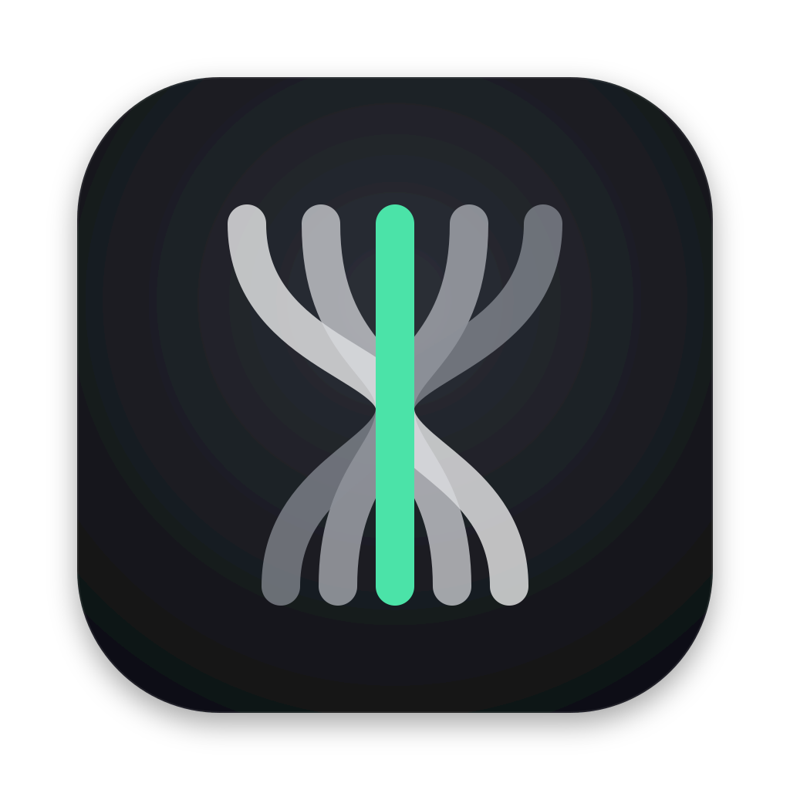
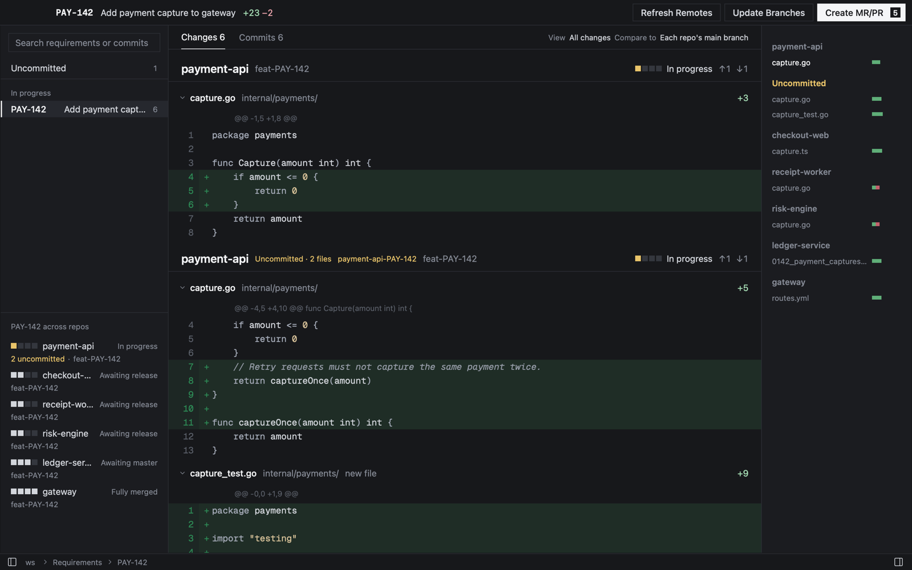

# Sheaf

**One requirement, many repositories, one diff.**

A requirement like `PAY-142` often touches six repositories at once. To review it you open each one, find its branch, read its diff, and remember which repo has merged where. Sheaf does that for you: type the requirement number and every repository's changes appear in one place, with how far each has merged.

[简体中文](README.zh-CN.md)



## How it works

1. **Open the folder** that holds your repositories. Sheaf finds every repository and worktree in it.
2. **Type a requirement number** and **Follow** it. Sheaf finds every branch whose name contains it.
3. **Read.** The left side shows each repository's stage (in progress, awaiting release, fully merged…); the middle is every change, repository by repository.

The only convention: **put the requirement number in the branch name**, and start commit subjects with it. Nothing to install in your repositories, no server, no account.

Using a coding agent? Send it this line and it sets the convention up for your workspace:

> Read https://github.com/no-today/sheaf/blob/main/docs/templates/agent-commit-convention.md and follow "Set up in a workspace" to install the commit convention in this workspace.

When you are done reading, **Refresh Remotes**, **Update Branches** and **Create MR/PR** act on all the repositories at once, after showing you what they will do.

## Install

Requires macOS and Git ≥ 2.31.

1. Download `sheaf-<version>.dmg` from the [latest release](https://github.com/no-today/sheaf/releases/latest) and drag **Sheaf.app** into **Applications**. Sheaf runs on Apple silicon Macs only.
2. The app is not notarized. If macOS blocks the first launch, open **System Settings → Privacy & Security** and click **Open Anyway**, or run:

   ```sh
   xattr -dr com.apple.quarantine /Applications/Sheaf.app
   ```

To create MRs or PRs, install and sign in to [glab](https://gitlab.com/gitlab-org/cli) or [gh](https://cli.github.com/); reading changes works without them.

<details>
<summary>Build from source</summary>

Install Apple's command line tools (`xcode-select --install`) and the Go version in [go.mod](go.mod), then:

```sh
git clone https://github.com/no-today/sheaf.git
cd sheaf
go mod download
go tool mygo build -skip-dmg -skip-notarize
open "build/darwin-$(go env GOARCH)/Sheaf.app"
```

`go tool mygo dev` rebuilds and restarts the app as you edit. See [CONTRIBUTING.md](CONTRIBUTING.md).

</details>

## CLI

In the app, choose **Sheaf → Settings → General → Install**, then run `sheaf --help` in a new terminal. This installs `/usr/local/bin/sheaf` and zsh completion as links into the app; updating the app updates both. Remove them with **Sheaf → Settings → General → Uninstall**.

GUI and CLI share `~/.sheaf`; a binary named `sheaf-dev` uses `~/.sheaf-dev`. `SHEAF_HOME` overrides the data root. Configuration lives at `<root>/workspaces/<id>/workspace.json`, operation records beside it, and disposable indexes under `<root>/cache/`. `sheaf config show` reports the actual paths. Use `--workspace` on first use; later commands can locate a saved workspace from a child repository or known worktree.

Read `sheaf --help` for concepts, commands, options, exit codes and agent guidance. Use `sheaf help <command>` (or `sheaf <command> --help`) for arguments and examples, and `sheaf help json` for the versioned JSON contract, field meanings and recovery actions. `sheaf --version` reports the build version.

The app installs zsh Tab completion with the command. To load it manually, add `source <(sheaf completion zsh)` to `~/.zshrc` after `compinit`. Bash users add `eval "$(sheaf completion bash)"` to `~/.bashrc` (macOS bash 3.2 cannot `source` a process substitution). For `sheaf-dev`, use that name in the same command. Completion suggests commands, supported options, saved workspaces, tracked requirements (with saved titles in zsh), merge stages and included repositories from the last scan. It only reads saved metadata and never calls Git or creates app data. `config apply` uses the shell's file completion.

For AI agents, always pass `--json`. Decide by the exit code, `complete`, `problems[].code` and `error.code`; never parse human text. If you do not know which workspace to use, or lookup fails (exit `3`, `error.code` is `workspace`), run `sheaf workspaces --json`, choose a `root` whose `exists` is `true`, and pass it as `--workspace <root>`. Start with `sheaf status --json`, pick an id, read `sheaf show <id> --json` for absolute repository paths, stages and missing commit SHAs; pass `sheaf show <id> --files --json` for uncommitted files, each with an absolute `worktree` and a `path` relative to it. Then page through `sheaf commits <id> --json`, passing `--cursor <result.next>` until `next` is `""`. Inspect code with `git -C <path> show <sha>` or `git -C <path> diff <a> <b>`; read uncommitted content with `git -C <worktree> diff -- <path>` using the file entry's `worktree` and `path`.

`check` answers whether everything has merged through the flow; `check <id> --stage <name>` checks only one target. Queries preserve tracked/archive state and configuration. Run write commands only when the user asks; `--fetch` contacts remotes. New clones appear with `--rescan`; known worktrees are always reloaded, and the first query discovers repositories if no saved scan exists. A GUI workspace refresh also updates that scan.

Try the agent flow with disposable repositories and isolated app data:

```sh
demo=$(mktemp -d)
export SHEAF_HOME="$demo/data"
scripts/mkfixture.sh "$demo/fixture"
mkdir -p "$demo/bin"
go build -o "$demo/bin/sheaf" ./cmd/sheaf
export PATH="$demo/bin:$PATH"

printf '%s\n' '{"requirement":"[A-Z]+-[0-9]+","mergeFlow":[{"name":"release","branch":"release"},{"name":"production","branch":"master"}]}' > "$demo/workspace.json"
sheaf --workspace "$demo/fixture/ws" config apply "$demo/workspace.json" --json
sheaf --workspace "$demo/fixture/ws" track PAY-142 --json
sheaf --workspace "$demo/fixture/ws" status --json
sheaf --workspace "$demo/fixture/ws" show PAY-142 --json
sheaf --workspace "$demo/fixture/ws" commits PAY-142 --json
```

For complete command examples and result definitions, use the built-in help; its examples are executed against temporary fixture workspaces in CLI tests.

## Safe by design

Sheaf is for reading. It never commits, rebases, force-pushes or stashes, and leaves folders with uncommitted changes alone, except a single file you confirm discarding. Its only writes are refreshing remotes, fast-forwarding favourite branches and creating MR/PRs, each listed in the **Activity log** (**Settings → Data**).

## More

[Product overview](docs/product/overview.md) · [Architecture](docs/agent/architecture.md) · [Contributing](CONTRIBUTING.md) · [Changelog](CHANGELOG.md) · [Known issues](ISSUES.md)

Built with [mygo](https://github.com/egoist/mygo). [MIT](LICENSE) · © 2026 no-today
