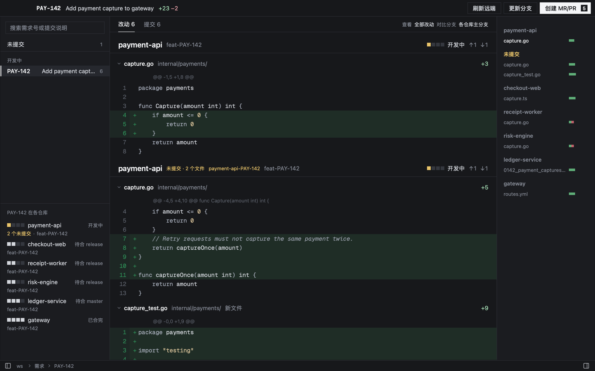

# Sheaf

**一个需求，多个仓库，一份改动。**

一个需求（比如 `PAY-142`）常常同时改了六个仓库。要审它，得一个个打开仓库、找到分支、看差异，还要记住哪个仓库合到了哪一步。Sheaf 替你做这件事：输入需求号，所有仓库的改动集中到一处，各自合到哪一步也一目了然。

[English](README.md)



## 怎么用

1. **打开放仓库的文件夹**。Sheaf 会找出里面所有的仓库和工作目录。
2. **输入需求号，点「关注」**。Sheaf 找出分支名里带这个号的所有分支。
3. **看。** 左边是各仓库的阶段（开发中、待合 release、已合完……）；中间是全部改动，按仓库依次排开。

唯一的约定：**分支名里带需求号**，提交标题也以它开头。不用在仓库里装任何东西，没有服务器，不用注册。

用 Coding Agent 写代码？把这句话发给它，它会把约定配置到你的工作区：

> 读 https://github.com/no-today/sheaf/blob/main/docs/templates/agent-commit-convention.zh-CN.md ，按「配置到工作区」一节把提交约定装进这个工作区。

看完之后，「刷新远端」「更新分支」「创建 MR/PR」能一次作用到所有仓库，执行前会先列出要做的事。

## 安装

需要 macOS 和 Git ≥ 2.31。

1. 从[最新版本](https://github.com/no-today/sheaf/releases/latest)下载 `sheaf-<版本号>.dmg`，把 **Sheaf.app** 拖进**应用程序**。只支持 Apple 芯片的 Mac。
2. 应用未经 Apple 公证。如果首次打开被拦截，到**系统设置 → 隐私与安全性**点**仍要打开**，或者运行：

   ```sh
   xattr -dr com.apple.quarantine /Applications/Sheaf.app
   ```

要创建 MR/PR，需安装并登录 [glab](https://gitlab.com/gitlab-org/cli) 或 [gh](https://cli.github.com/)；只看改动不需要。

<details>
<summary>从源码构建</summary>

安装 Apple 命令行工具（`xcode-select --install`）和 [go.mod](go.mod) 指定的 Go 版本，然后：

```sh
git clone https://github.com/no-today/sheaf.git
cd sheaf
go mod download
go tool mygo build -skip-dmg -skip-notarize
open "build/darwin-$(go env GOARCH)/Sheaf.app"
```

开发时用 `go tool mygo dev`，改代码后自动构建并重启。详见 [CONTRIBUTING.md](CONTRIBUTING.md)。

</details>

## 命令行

在应用中选择 **Sheaf → 设置 → 通用 → 安装**，然后在新终端中运行 `sheaf --help`。命令 `/usr/local/bin/sheaf` 与 zsh 补全一起链接到应用内，更新应用时两者也会更新。选择 **Sheaf → 设置 → 通用 → 卸载** 即可移除这两个链接。

GUI 和 CLI 共用 `~/.sheaf` 中的工作区与设置，`SHEAF_HOME` 可覆盖数据目录。运行 `sheaf --version` 查看版本，`sheaf --help` 查看命令，`sheaf help json` 查看供 Agent 使用的 JSON 契约。

应用安装命令时已包含 zsh Tab 补全。若需手动加载，可在 `~/.zshrc` 的 `compinit` 之后添加 `source <(sheaf completion zsh)`；bash 用户在 `~/.bashrc` 添加 `eval "$(sheaf completion bash)"`。使用 `sheaf-dev` 时，将命令中的程序名改为 `sheaf-dev`。

## 放心用

Sheaf 只用来看。它不提交、不变基、不强推、不自动 stash，也不碰有未提交改动的目录（你确认还原的单个文件除外）。它只做三种写操作：刷新远端、快进收藏分支、创建 MR/PR，每一条都记在「操作记录」里（**设置 → 数据**）。

## 更多

[产品定位](docs/product/overview.md) · [架构](docs/agent/architecture.md) · [参与贡献](CONTRIBUTING.md) · [更新记录](CHANGELOG.md) · [已知问题](ISSUES.md)

Built with [mygo](https://github.com/egoist/mygo)。[MIT](LICENSE) · © 2026 no-today
